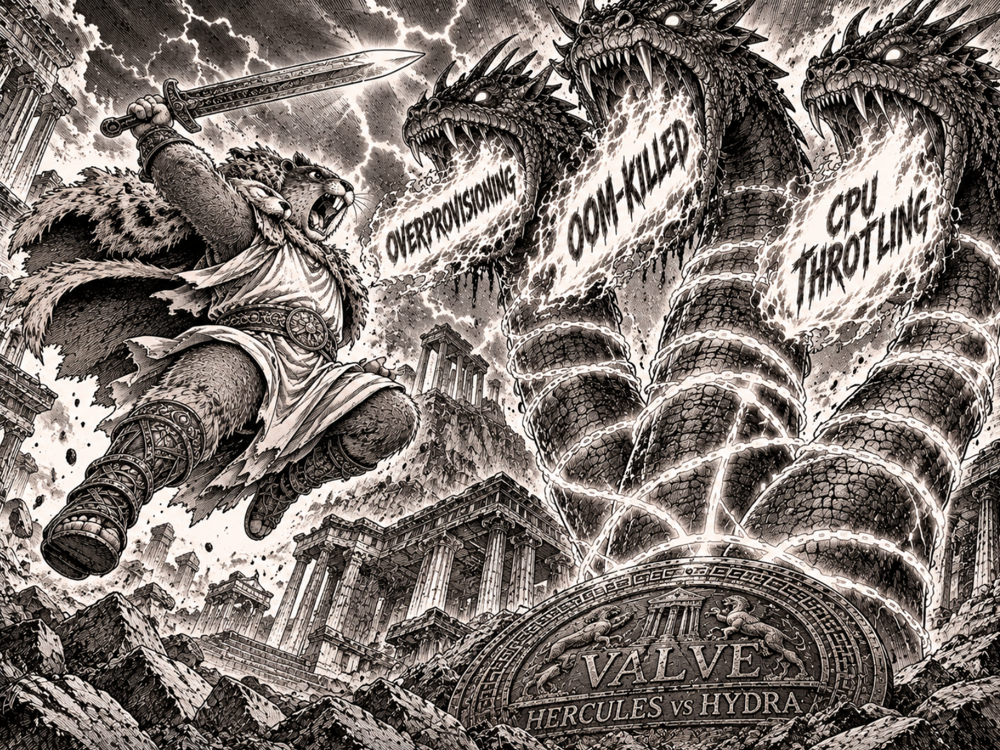

# Valve - платформа автономной FinOps-оптимизации ресурсов Kubernetes

Репозиторий с кодом, архитектурой и результатами научно-исследовательской работы.

## Информация

- **Университет:** НИУ ИТМО
- **Факультет:** Прикладной информатики
- **Направление подготовки:** 11.04.02 Инфокоммуникационные технологии и системы связи
- **Образовательная программа:** Разработка и эксплуатация промышленного бэкенда
- **Тема НИР:** Исследование и разработка eBPF-компонентов автоматического проактивного управления и оптимизации лимитов вычислительных ресурсов
- **Обучающийся:** Казанцев Александр Сергеевич
- **Группа:** К4112с
- **Научный руководитель:** Мигулаева Татьяна Алексеевна

---

## О проекте

**Valve** - это автономный инструмент для оптимизации ресурсов (`requests` и `limits`) в кластерах Kubernetes.

Обычные системы мониторинга (`cAdvisor`, `Metrics Server`) смотрят на контейнер снаружи и опрашивают `cgroups` раз в 10-15 секунд. Из-за этого они пропускают короткие миллисекундные всплески памяти, на которых сервисы падают с `OOMKilled`. Я решаю эту проблему с помощью **eBPF**: агент на Си снимает внутренние метрики рантайма Go-приложений (выделение памяти, активность горутин, паузы сборщика мусора) прямо из ядра Linux без изменения исходного кода самих сервисов.

**Три главные проблемы продакшена, которые закрывает Valve:**

- **Overprovisioning (завышенные лимиты).** Разработчики закладывают ресурсы с большим запасом, из-за чего реальная утилизация кластеров составляет 5-40%, а компания платит за простаивающее железо.
- **Underprovisioning (дефицит ресурсов).** При росте нагрузки или после нового релиза лимитов не хватает, и сервис убивается `OOM Killer` или начинает тормозить из-за `CPU Throttling`.
- **Дрейф профиля нагрузки.** Потребление сервисов постоянно меняется после новых фич и оптимизаций, а статические цифры в YAML-манифестах за ними не успевают.

## Архитектура и подход

Я разделяю систему на две независимые плоскости:

- **Control Plane (управление и применение).** eBPF-агент в виде `DaemonSet`, хранение метрик в `PostgreSQL`, `Mutating Admission Webhook` для подстановки лимитов новым подам, `Controller` для обновления ресурсов, `Policy Engine` с замками и исключениями, а также журнал `Audit Log`.
- **Decision Plane (расчёт рекомендаций).** Сервис на Go с единым интерфейсом для подключаемых алгоритмов: собственный движок `ValvePredictive` на eBPF-метриках, адаптер к `Robusta KRR`, статистический `Percentile Engine`, `Static Rules` и открытый API для своих движков.

Изменения применяются гибридно. Где это возможно - через **Kubernetes In-place Pod Resource Resize API** на лету, без перезапуска подов. Где обновление без рестарта невозможно (например, меняется QoS-класс или новый лимит памяти ниже текущего потребления) - через управляемый перезапуск с полной прозрачностью в интерфейсе.

Valve не заменяет Robusta KRR напрямую, а работает как надстройка над ним. KRR только считает цифры рекомендаций, а Valve решает, можно ли их применить, когда и как это сделать безопасно, и как откатить изменения при проблемах. Управление вынесено в веб-панель **Valve Control Center** (`React` + `TypeScript`), вшитую в Go API-сервер (`go:embed`), что избавляет команду от рутины с десятками ручных Merge Request.

---

## Технологический стек

- **Ядро сбора телеметрии (Kernel space):** Язык C, подсистема eBPF (`clang` и `LLVM`, подход CO-RE, загрузка через `sys_bpf`), точки перехвата (`tracepoints`, `kprobes`, `uprobes`), чтение `task_struct` и `cgroup_id`, передача данных через `BPF Ring Buffer`.
- **Кластерная оркестрация (User space):** Язык Go, библиотека `cilium/ebpf`, `client-go` и `controller-runtime` (`DaemonSet`, `Mutating Admission Webhook`, `Controller`).
- **Decision Plane и Policy Engine:** Go (подключаемые движки рекомендаций, предохранители `locks`, `exceptions`, `cooldown`, `step threshold`, `canary`, `min/max`).
- **Веб-интерфейс (Valve Control Center):** `React` + `TypeScript`, упакованные в бинарный файл Go-сервера через `go:embed`.
- **Хранение данных:** `PostgreSQL` (временные ряды метрик, рекомендации, `Audit Log`).

---

## Дорожная карта (Этапы НИР)

- **[Этап 1. Исследование и теоретический фундамент](./docs/phase-01-research.md)** _(завершён, 1 семестр - ноябрь 2026)_ - разбор механики `cgroups v2`, слепых зон `Prometheus`/`cAdvisor`, архитектуры Kubernetes Control Plane, FinOps-инструментов (`KRR`, `VPA`, `Cast AI`) и проектирование архитектуры Valve.
- **[Этап 2. Сбор телеметрии и eBPF-прототипирование](./docs/phase-02-ebpf.md)** _(в работе, 2 семестр - март 2027)_ - разработка eBPF-программ на Си для съёма метрик памяти (`RSS`, аллокации в куче), активности планировщика горутин, пауз GC и задержек потоков ОС из пространства ядра.
- **[Этап 3. Разработка распределённого агента](./docs/phase-03-agent.md)** _(3 семестр - ноябрь 2027)_ - создание демона на Go для чтения BPF-карт, упаковка в Kubernetes `DaemonSet`, запись метрик в `PostgreSQL` и замер накладных расходов агента.
- **[Этап 4. Интеграция с Kubernetes API и Webhooks](./docs/phase-04-orchestration.md)** _(3 семестр - январь 2028)_ - реализация `Mutating Admission Webhook`, контроллера на `controller-runtime` с поддержкой `In-place Pod Resize`, управляемого `rollout` и слоя защиты `Policy Engine`.
- **[Этап 5. Decision Plane и подключаемые движки](./docs/phase-05-decision-plane.md)** _(4 семестр - март 2028)_ - сервис расчёта рекомендаций на Go, открытый API для сторонних алгоритмов, реализация `ValvePredictive`, `KRR Adapter`, `Percentile Engine` и `Static Rules`.
- **[Этап 6. Разработка веб-пульта управления](./docs/phase-06-webui.md)** _(4 семестр - май 2028)_ - создание веб-интерфейса **Valve Control Center** на базе `Go` (`go:embed`), `React` и `TypeScript`.
- **[Этап 7. Экспериментальный анализ и оценка эффективности](./docs/phase-07-evaluation.md)** _(4 семестр - июнь 2028)_ - сравнение точности и скорости реакции eBPF-агента против `cAdvisor`, нагрузочное тестирование в кластере, сравнение движков рекомендаций и расчёт FinOps-эффекта.

---

## Источники информации

- **[База знаний, статьи и профильная литература](./docs/materials.md)** - каталог учебных материалов, спецификаций и книг по ядру Linux, eBPF и Kubernetes.
